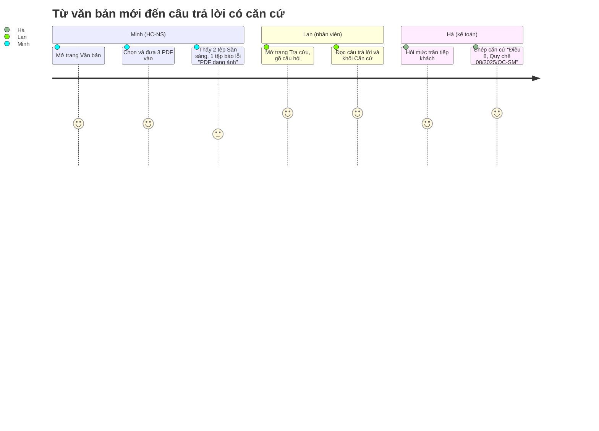

# PRD — Tra cứu quy chế (TCQC)

| Mục | Giá trị |
|---|---|
| Document ID | TCQC-PRD |
| Version | 0.1 |
| Status | In review |
| Owner / Approver | Phùng Duy Hùng (PO) |
| Author | AI agent (Claude Code) |
| Date | 2026-11-02 |
| Prompt | `sdlc-kit/analysis/PRD_Prompt_IEEE_standard.md` v2.0; tham số: `prompts/03-analysis.md` |
| Đầu vào | `docs/02-requirements/BRD.md` v1.0 (`requirements-v1`) |
| User stories | [USER_STORIES.md](USER_STORIES.md) |
| Truy vết | [traceability.md](traceability.md) |

## 0. Kiểm tra product pillars với BRD

| Pillar | BRD hỗ trợ | Kết quả |
|---|---|---|
| Có căn cứ cho mọi ý | BR-005 | Hỗ trợ |
| Đúng văn bản đang hiệu lực | BR-006, BR-007, BR-013, BR-015 | Hỗ trợ |
| Từ chối khi không có | BR-008 | Hỗ trợ |
| Không lưu nội dung | BR-011 | Hỗ trợ |

Không có pillar nào thiếu căn cứ trong BRD.

## 1. Executive Summary & Strategy

### 1.1 Product Vision

Mọi quyết định chi tiêu, nghỉ phép, kỷ luật trong công ty đều dựa trên đúng quy định đang áp dụng, tra được trong vài giây, có căn cứ để kiểm lại [Source: BRD §4.2].

### 1.2 Objectives & Key Results

| OKR | Key result | Baseline | Target | Cách đo | BRD |
|---|---|---|---|---|---|
| O1: Tra nhanh | KR1: thời gian người dùng có câu trả lời | ~15 phút (ASM-001) | ≤ 2 phút | Bấm giờ 5 câu khi nghiệm thu | MET-001 |
| | KR2: thời gian hệ thống trả lời | — (hệ thống mới) | p90 ≤ 30 giây | Golden set | MET-006 |
| O2: Căn cứ đúng | KR3: câu dương tính trả lời đúng và trích đúng Điều | — | ≥ 80 % | Golden set, PO chấm | MET-002 |
| | KR4: câu xung đột áp dụng đúng văn bản | — | 100 % | Golden set | MET-003 |
| O3: Không bịa | KR5: câu âm tính được từ chối | — | ≥ 90 % | Golden set | MET-004 |

## 2. User Personas & User Journeys

### 2.1 Target Personas

| Persona | Nhóm (BRD §4.6) | Mục tiêu | Mức hiểu quy chế | Ưu tiên |
|---|---|---|---|---|
| **Lan — nhân viên kinh doanh** | STK-02 | Biết phụ cấp, ngày phép trước khi làm thủ tục | Thấp | Primary |
| **Minh — chuyên viên HC-NS** | STK-03 | Đưa văn bản mới vào; trả lời nhanh câu hỏi của nhân viên | Cao | Primary |
| **Hà — kế toán thanh toán** | STK-04 | Có căn cứ Điều/Khoản để ghi vào hồ sơ chi | Cao | Secondary |

Tên persona là hư cấu, chỉ minh họa nhóm người dùng.

### 2.2 High-Level User Journey

## 3. Functional Requirements & User Stories

### 3.1 Functional requirements

| ID | Yêu cầu (hệ thống shall …) | BR | Priority | Tiêu chí đo được |
|---|---|---|---|---|
| FR-001 | nhận 1–10 tệp PDF trong một lần đưa vào | BR-001, BRU-004 | P0 | 10 tệp hợp lệ được nhận; tệp thứ 11 làm cả lần bị từ chối với lý do "quá 10 tệp" |
| FR-002 | xét từng tệp và trả về đúng một lý do khi từ chối: không phải PDF, vượt 20 MB, quá 300 trang, có mật khẩu, PDF dạng ảnh, tệp hỏng, trùng tên, kho đã đủ 50 văn bản | BR-002, BRU-004, BRU-005 | P0 | Mỗi loại lỗi cho đúng thông điệp tiếng Việt; tệp hợp lệ trong cùng lần vẫn được nhận |
| FR-003 | đọc số hiệu, tên văn bản và ngày hiệu lực từ nội dung văn bản; "hiệu lực kể từ ngày ký" thì lấy ngày ký | BR-003, BRU-002 | P0 | Đúng cho 100 % văn bản mẫu |
| FR-004 | hiển thị danh sách văn bản với trạng thái (Đang xử lý, Sẵn sàng, Lỗi + lý do), số hiệu, ngày hiệu lực; tự cập nhật trạng thái | BR-002, BR-003 | P0 | Trạng thái mới hiện trên danh sách ≤ 5 giây sau khi đổi |
| FR-005 | chỉ dùng văn bản ở trạng thái Sẵn sàng để trả lời | BR-004 | P0 | Văn bản Đang xử lý / Lỗi không xuất hiện trong căn cứ |
| FR-006 | nhận câu hỏi tiếng Việt dài 1–2000 ký tự | BR-004 | P0 | Câu rỗng hoặc > 2000 ký tự bị từ chối kèm thông báo |
| FR-007 | trả lời chỉ dựa trên các văn bản Sẵn sàng; mỗi ý có số tham chiếu [n] trỏ tới một căn cứ | BR-004, BR-005, BR-016 | P0 | Golden set: MET-002 ≥ 80 %, MET-007 ≥ 80 % |
| FR-008 | hiện danh sách căn cứ dưới câu trả lời: [n], Điều (và Khoản nếu có), tên văn bản, số hiệu, ngày hiệu lực, trang | BR-005 | P0 | Mọi căn cứ có đủ năm thành phần khi văn bản có thông tin đó |
| FR-009 | khi hai văn bản đang hiệu lực khác nhau về cùng một việc, áp dụng văn bản có ngày hiệu lực muộn hơn và nêu số hiệu cùng mức của văn bản bị thay | BR-006, BR-007, BRU-001 | P0 | Golden set: MET-003 = 100 %, AC-007 |
| FR-010 | với văn bản chưa đến ngày hiệu lực: giữ quy định đang áp dụng, ghi "sắp có hiệu lực" kèm ngày | BR-013, BR-015, BRU-003 | P1 | Câu kiểm thử về văn bản tương lai đạt AC-013, AC-015 |
| FR-011 | khi không văn bản nào quy định điều được hỏi, trả lời đúng câu "Không tìm thấy quy định này trong các văn bản đã tải lên." và không kèm căn cứ | BR-008 | P0 | Golden set: MET-004 ≥ 90 % |
| FR-012 | coi nội dung văn bản là dữ liệu, không làm theo chỉ dẫn nằm trong văn bản | BR-012 | P0 | AC-012 |
| FR-013 | khi chưa có văn bản Sẵn sàng: khóa ô hỏi và hướng dẫn đưa văn bản vào | BR-004 | P1 | Ô hỏi bị khóa; có liên kết sang trang Văn bản |
| FR-014 | ghi một bản ghi số liệu cho mỗi câu hỏi: thời điểm, thời gian trả lời, kết quả (đúng hạn / lỗi), số căn cứ; không có nội dung | BR-010, BR-011 | P0 | AC-010, AC-011 |
| FR-015 | khi dịch vụ tạo câu trả lời lỗi hoặc quá thời gian, báo "Hệ thống đang bận, vui lòng thử lại" và giữ nguyên câu hỏi để hỏi lại | BR-009 | P0 | Câu hỏi vẫn còn trong ô; nút "Hỏi lại" chạy lại đúng câu đó |

### 3.2 Non-functional requirements

| ID | Thuộc tính | Ngưỡng | Cách đo | BR |
|---|---|---|---|---|
| NFR-001 | Độ trễ trả lời | p90 ≤ 30 giây trên golden set | Số liệu FR-014 khi chạy golden set | BR-009 |
| NFR-002 | Thời gian văn bản sẵn sàng | Văn bản ≤ 20 trang sẵn sàng ≤ 60 giây sau khi đưa vào [Unverified: OQ-007] | Đo khi chạy kiểm thử đưa văn bản | BR-001 (SN-03 "dùng ngay") |
| NFR-003 | Bảo mật nội dung | 0 lần nội dung câu hỏi, câu trả lời, văn bản xuất hiện trong log hay bảng số liệu | Tìm chuỗi câu hỏi mẫu trong log và CSDL sau khi chạy (AC-011) | BR-011 |
| NFR-004 | Phạm vi truy cập | Chỉ dải mạng nội bộ; giao tiếp qua HTTPS khi triển khai | Kiểm cấu hình triển khai (AC-014) | BR-014 |
| NFR-005 | Sẵn sàng | 08:00–17:30, thứ Hai–thứ Sáu; phục hồi ≤ 1 ngày làm việc bằng cách đưa lại văn bản gốc | Diễn tập: xóa kho, đưa lại 3 văn bản mẫu, đo thời gian | ASM-003, ASM-005 |
| NFR-006 | Tải đồng thời | 10 câu hỏi đồng thời không có lỗi [Unverified: OQ-007] | Gửi 10 câu cùng lúc, đếm lỗi | BR-009 |
| NFR-007 | Ngôn ngữ | 100 % chuỗi giao diện và thông báo lỗi bằng tiếng Việt | Kiểm tra giao diện | CON-04 |
| NFR-008 | Phân quyền | Không có (PO: mọi người dùng nội bộ có quyền như nhau, OQ-002); bảo vệ dựa vào NFR-004 | Inspection | BR-014 |

### 3.3 Epic / story matrix

| Epic | Stories | FR |
|---|---|---|
| E1 Kho văn bản | US-001 (P0), US-002 (P0) | FR-001..005 |
| E2 Tra cứu có căn cứ | US-003 (P0), US-004 (P0), US-005 (P0), US-006 (P1), US-008 (P0), US-009 (P1), US-010 (P0) | FR-006..013, FR-015 |
| E3 Đo lường | US-007 (P0) | FR-014 |

Chi tiết và Given-When-Then: [USER_STORIES.md](USER_STORIES.md).

## 4. UX & UI Requirements

### 4.1 Core flow logic

- Hai màn hình: **Tra cứu** (mặc định) và **Văn bản**.
- **Tra cứu:**
  - ô hỏi nhiều dòng; Enter để gửi, Shift+Enter để xuống dòng; bộ đếm ký tự x/2000;
  - mỗi lượt gồm câu hỏi, câu trả lời và khối **Căn cứ**, đánh số [n] khớp với số trong câu trả lời;
  - đầu màn hình hiện số văn bản đang dùng, bấm vào để sang màn hình Văn bản.
- **Văn bản:**
  - vùng chọn tệp ghi rõ giới hạn (10 tệp, 20 MB, 300 trang, chỉ PDF có lớp văn bản);
  - bảng gồm Tên văn bản (hoặc tên tệp), Số hiệu, Hiệu lực, Số trang, Trạng thái;
  - tự cập nhật khi còn văn bản Đang xử lý.
- Câu trả lời ghi rõ "do AI tạo — hãy đối chiếu Điều khoản gốc".

### 4.2 Edge cases & error states

| Tình huống | Hành vi | FR |
|---|---|---|
| Chưa có văn bản Sẵn sàng | Khóa ô hỏi, hiện hướng dẫn và nút sang Văn bản | FR-013 |
| Có văn bản Đang xử lý | Hiện thông báo "N văn bản đang xử lý, chưa được dùng để trả lời" | FR-005 |
| Chọn > 10 tệp | Từ chối cả lần trước khi gửi, ghi rõ số tệp đã chọn | FR-001 |
| Tệp lỗi trong một lần đưa vào | Liệt kê từng tệp lỗi kèm lý do; tệp hợp lệ vẫn được nhận | FR-002 |
| Câu hỏi rỗng / > 2000 ký tự | Nút gửi bị khóa; bộ đếm chuyển màu báo lỗi | FR-006 |
| Mất mạng / dịch vụ trả lời lỗi / quá thời gian | Thông báo bận, giữ câu hỏi, có nút "Hỏi lại" | FR-015 |
| Không tìm thấy quy định | Câu cố định của FR-011, không có khối Căn cứ | FR-011 |
| Văn bản không có số hiệu hoặc ngày hiệu lực | Hiện "—" ở cột tương ứng; căn cứ bỏ trống thành phần đó | FR-003, FR-008 |

## 5. Release Criteria & Post-Launch Metrics

### 5.1 Launch gate criteria

| # | Tiêu chí | Ngưỡng |
|---|---|---|
| RC-1 | Test tự động (unit + tích hợp) | 100 % xanh trên commit được phát hành |
| RC-2 | Golden set | MET-002 ≥ 80 %, MET-003 = 100 %, MET-004 ≥ 90 %, NFR-001 đạt |
| RC-3 | Test case P0 trong `docs/07-verification/TEST_CASES.md` | 100 % Pass, có bằng chứng |
| RC-4 | Bảo mật nội dung | NFR-003 đạt (0 lần lộ) |
| RC-5 | Review code | Biên bản IEEE 1028 không còn lỗi Major |
| RC-6 | Quyết định | PO ký GO trong `TEST_REPORT.md` |

### 5.2 Analytics & tracking

| Sự kiện | Trường | Dùng cho |
|---|---|---|
| `ask` (một bản ghi mỗi câu hỏi) | thời điểm, latency_ms, status (ok / error), cited_count, chunk_count, token vào/ra | MET-006, NFR-001, FR-014 |
| `ingest_done` / `ingest_failed` (log) | document_id, số trang, số đoạn, mã lỗi, processing_ms | NFR-002, FR-002 |

Không có trường nào chứa câu hỏi, câu trả lời hay nội dung văn bản (NFR-003).

## 6. Traceability summary và open questions

BO → BR → FR/NFR → US: [traceability.md](traceability.md). Tóm tắt coverage:

- 15 FR và 8 NFR, 100 % trỏ về BR (hoặc BRU/CON/ASM của BRD);
- 16/16 BR có FR hoặc NFR;
- 10 US, 100 % có AC và FR;
- không có `[ORPHAN]`.

| ID | Câu hỏi | Owner | Cần trước | Trạng thái |
|---|---|---|---|---|
| OQ-006 | Xác nhận target MET-007 và cỡ golden set (từ BRD) | PO | Trước chặng Test | Mở |
| OQ-007 | Xác nhận ngưỡng NFR-002 (≤ 60 giây cho văn bản 20 trang) và NFR-006 (10 câu hỏi đồng thời) | PO | Cổng PRD | Mở |
