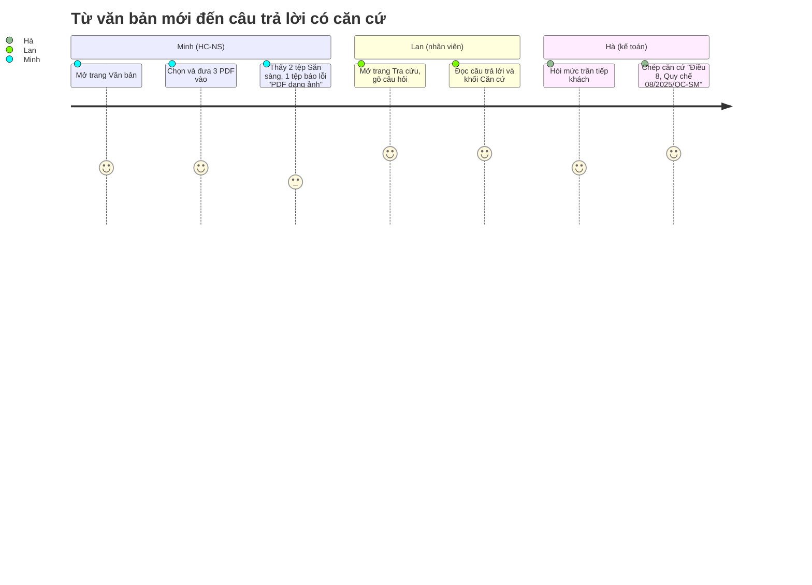

# PRD — Tra cứu quy chế (TCQC)

| Mục | Giá trị |
|---|---|
| Document ID | TCQC-PRD |
| Version | 0.3 |
| Status | In review (audit vòng 3) |
| Owner / Approver | Phùng Duy Hùng (PO) |
| Author | AI agent (Claude Code) |
| Date | 2026-11-02 |
| Prompt | `sdlc-kit/analysis/PRD_Prompt_IEEE_standard.md` v2.0; tham số: `prompts/03-analysis.md` |
| Đầu vào | `docs/02-requirements/BRD.md` v1.0 (`requirements-v1`); `docs/01-intake/glossary.md`, `stakeholders.md` (`intake-v1`) |
| Thay đổi 0.2 | Sửa theo `prd-audit.md` vòng 1; ghi quyết định PO về OQ-006, OQ-007, DEP-001 (2026-11-02) |
| Thay đổi 0.3 | Sửa theo vòng 2: biên bản SRC-006; thêm §1.3 Scope và §1.4 Interfaces (khai báo theo §5 output contract); đổi FR-004b/007b/009b → FR-018/019/020; bỏ 95 % chưa có nguồn |
| Nguồn quyết định | [decisions/SRC-006.md](decisions/SRC-006.md) |
| User stories | [USER_STORIES.md](USER_STORIES.md) |
| Truy vết | [traceability.md](traceability.md) |

## 0. Kiểm tra product pillars với BRD

| Pillar | BRD hỗ trợ | Kết quả |
|---|---|---|
| Có căn cứ cho mọi ý | BR-005 | Hỗ trợ |
| Đúng văn bản đang hiệu lực | BR-006, BR-007, BR-013, BR-015 | Hỗ trợ |
| Từ chối khi không có | BR-008 | Hỗ trợ |
| Không lưu nội dung | BR-011 | Hỗ trợ |

Không có pillar nào thiếu căn cứ trong BRD.

## 1. Executive Summary & Strategy

### 1.1 Product Vision

Mọi quyết định chi tiêu, nghỉ phép, kỷ luật trong công ty đều dựa trên đúng quy định đang áp dụng; người dùng tra được trong ≤ 2 phút (MET-001), có căn cứ để kiểm lại [Source: BRD §4.2].

### 1.2 Objectives & Key Results

| OKR | Key result | Baseline | Target | Cách đo | BRD |
|---|---|---|---|---|---|
| O1: Tra nhanh | KR1: thời gian người dùng có câu trả lời | ~15 phút (ASM-001) | ≤ 2 phút | Bấm giờ 5 câu khi nghiệm thu | MET-001 |
| | KR2: thời gian hệ thống trả lời | Không có (hệ thống mới, chưa từng đo) | p90 ≤ 30 giây | Golden set | MET-006 |
| O2: Căn cứ đúng | KR3: câu dương tính trả lời đúng và trích đúng Điều | Không có (tra tay, chưa ghi nhận) | ≥ 80 % | Golden set, PO chấm | MET-002 |
| | KR4: câu xung đột áp dụng đúng văn bản | Không có (như trên) | 100 % | Golden set | MET-003 |
| O3: Không bịa | KR5: câu âm tính được từ chối | Không có (như trên) | ≥ 90 % | Golden set | MET-004 |

### 1.3 Scope, environment, constraints, dependencies

- **Scope:** như BRD §4.5. In scope: kho văn bản PDF có lớp văn bản, tra cứu có căn cứ, xử lý hiệu lực, số liệu không nội dung. Out of scope: đăng nhập/phân quyền, OCR/DOCX, soạn văn bản, tư vấn pháp lý, lưu lịch sử hỏi đáp, di động, tích hợp. Ranh giới: từ lúc văn bản vào kho đến lúc người dùng đọc câu trả lời.
- **Operating environment:** trình duyệt máy tính để bàn (Chrome/Edge/Firefox bản hiện hành, màn hình ≥ 1280 px) trong mạng nội bộ. Hệ thống chạy trên một máy chủ nội bộ; trong capstone là máy cục bộ (DEP-004).
- **Constraints:** CON-01..CON-07 (BRD §4.9). Không có quy định pháp lý áp dụng (dữ liệu giả lập, CON-02).

| Dependency (BRD §4.10) | Ảnh hưởng tới | Quyết định / trạng thái |
|---|---|---|
| DEP-001 Dịch vụ tạo câu trả lời | FR-007..FR-012, FR-015, NFR-001 | **PO quyết định 2026-11-02 (SRC-006 D4):** không có nội dung nào được gửi ra ngoài công ty trong giai đoạn này. Cách tạo câu trả lời được quyết ở ADR (chặng Design). Đây là biện pháp giảm thiểu RSK-004; RSK-004 vẫn mở cho giai đoạn dùng thật (BRD không đổi) |
| DEP-002 Bộ văn bản mẫu | FR-003, FR-009, FR-010, FR-012 | Soạn ở chặng Design (dữ liệu giả lập) |
| DEP-003 Golden set và người chấm | KR3..KR5, MET-007, NFR-001 | Soạn ở chặng Test; cỡ theo OQ-006 (SRC-006 D3) |
| DEP-004 Môi trường nội bộ | NFR-004, NFR-005 | Máy cục bộ trong capstone |
| DEP-005 PO có mặt ở mọi cổng | Lịch | Đang đáp ứng |

### 1.4 Software & communication interfaces (logic)

| Giao diện | Vào | Ra | Lỗi | FR |
|---|---|---|---|---|
| IF-01 Đưa văn bản vào | 1–10 tệp PDF | Mỗi tệp: nhận (mã văn bản, trạng thái Đang xử lý) hoặc từ chối (mã lý do) | Cả lần bị từ chối khi > 10 tệp | FR-001, FR-002, FR-016 |
| IF-02 Danh sách văn bản | — | Mỗi văn bản: tên, tên tệp, số hiệu, ngày hiệu lực, số trang, trạng thái, mã lỗi | — | FR-004 |
| IF-03 Tra cứu | Câu hỏi 1–2000 ký tự | Câu trả lời, thời gian trả lời, danh sách căn cứ | Câu hỏi không hợp lệ; chưa có văn bản; hệ thống bận | FR-006..FR-011, FR-015 |
| IF-04 Thành phần tạo câu trả lời (nội bộ, DEP-001) | Câu hỏi, các phần văn bản liên quan kèm thông tin văn bản | Văn bản trả lời có [n], hoặc câu không tìm thấy | Lỗi hoặc quá 30 giây → FR-015 | FR-007, FR-015 |

Kênh giao tiếp: trình duyệt với hệ thống qua HTTP trong máy cục bộ. Khi triển khai trong mạng công ty dùng HTTPS (NFR-004). Không có kênh ra ngoài công ty (DEP-001).

## 2. User Personas & User Journeys

### 2.1 Target Personas

| Persona | Nhóm (BRD §4.6) | Mục tiêu | Mức hiểu quy chế | Ưu tiên |
|---|---|---|---|---|
| **Lan — nhân viên kinh doanh** | STK-02 | Biết phụ cấp, ngày phép trước khi làm thủ tục | Thấp | Primary |
| **Minh — chuyên viên HC-NS** | STK-03 | Đưa văn bản mới vào; trả lời nhanh câu hỏi của nhân viên | Cao | Primary |
| **Hà — kế toán thanh toán** | STK-04 | Có căn cứ Điều/Khoản để ghi vào hồ sơ chi | Cao | Secondary |

Tên persona là hư cấu, chỉ minh họa nhóm người dùng.

### 2.2 High-Level User Journey

## 3. Functional Requirements & User Stories

### 3.1 Functional requirements

| ID | Yêu cầu (hệ thống shall …) | BR | Priority | Tiêu chí đo được |
|---|---|---|---|---|
| FR-001 | nhận 1–10 tệp PDF trong một lần đưa vào | BR-001, BRU-004 | P0 | 10 tệp hợp lệ được nhận; chọn 11 tệp thì cả lần bị từ chối ngay khi chọn, trước khi gửi, với thông báo "Mỗi lần chỉ tải tối đa 10 tệp" |
| FR-002 | xét từng tệp và trả về đúng một lý do khi từ chối: không phải PDF, vượt 20 MB, quá 300 trang, có mật khẩu, PDF dạng ảnh, tệp hỏng, trùng tên (kho đầy: FR-016) | BR-002, BRU-004, BRU-005 | P0 | Mỗi loại lỗi cho đúng thông điệp tiếng Việt; tệp hợp lệ trong cùng lần vẫn được nhận |
| FR-003 | đọc số hiệu, tên văn bản và ngày hiệu lực từ nội dung văn bản; "hiệu lực kể từ ngày ký" thì lấy ngày ký | BR-003, BRU-002 | P0 | Đúng cho 100 % văn bản mẫu |
| FR-004 | hiển thị danh sách văn bản, mỗi văn bản có trạng thái (Đang xử lý, Sẵn sàng, Lỗi + lý do), số hiệu và ngày hiệu lực | BR-002, BR-003 | P0 | Đủ cột cho 100 % văn bản |
| FR-018 | tự cập nhật trạng thái trên danh sách khi còn văn bản Đang xử lý | BR-003 | P0 | Trạng thái mới hiện ≤ 5 giây sau khi đổi |
| FR-005 | chỉ dùng văn bản ở trạng thái Sẵn sàng để trả lời | BR-004 | P0 | Văn bản Đang xử lý / Lỗi không xuất hiện trong căn cứ |
| FR-006 | nhận câu hỏi tiếng Việt dài 1–2000 ký tự | BR-004 | P0 | Câu rỗng hoặc > 2000 ký tự bị từ chối kèm thông báo |
| FR-007 | trả lời chỉ dựa trên nội dung các văn bản Sẵn sàng | BR-004, BR-016 | P0 | Golden set: MET-002 ≥ 80 %, MET-007 ≥ 80 % |
| FR-019 | gắn cho mỗi ý của câu trả lời một số tham chiếu [n] trỏ tới một căn cứ | BR-005 | P0 | 100 % câu trả lời dương tính có ít nhất một [n] hợp lệ |
| FR-008 | hiện danh sách căn cứ dưới câu trả lời: [n], Điều (và Khoản nếu có), tên văn bản, số hiệu, ngày hiệu lực, trang | BR-005 | P0 | Mọi căn cứ có đủ năm thành phần khi văn bản có thông tin đó |
| FR-009 | khi hai văn bản đang hiệu lực khác nhau về cùng một việc, áp dụng văn bản có ngày hiệu lực muộn hơn | BR-006, BRU-001 | P0 | Golden set: MET-003 = 100 % |
| FR-020 | khi áp dụng FR-009, nêu số hiệu và quy định của văn bản bị thay | BR-007 | P0 | AC-007 |
| FR-010 | với văn bản chưa đến ngày hiệu lực: giữ quy định đang áp dụng, ghi "sắp có hiệu lực" kèm ngày | BR-013, BR-015, BRU-003 | P1 | Câu kiểm thử về văn bản tương lai đạt AC-013, AC-015 |
| FR-011 | khi không văn bản nào quy định điều được hỏi, trả lời đúng câu "Không tìm thấy quy định này trong các văn bản đã tải lên." và không kèm căn cứ | BR-008 | P0 | Golden set: MET-004 ≥ 90 % |
| FR-012 | coi nội dung văn bản là dữ liệu, không làm theo chỉ dẫn nằm trong văn bản | BR-012 | P0 | AC-012 |
| FR-013 | khi chưa có văn bản Sẵn sàng: khóa ô hỏi và hướng dẫn đưa văn bản vào | BR-004 | P1 | Ô hỏi bị khóa; có liên kết sang trang Văn bản |
| FR-014 | ghi một bản ghi số liệu cho mỗi câu hỏi: thời điểm, thời gian trả lời, kết quả (đúng hạn / lỗi), số căn cứ; không có nội dung | BR-010, BR-011 | P0 | AC-010, AC-011 |
| FR-015 | khi thành phần tạo câu trả lời lỗi hoặc quá 30 giây, báo "Hệ thống đang bận, vui lòng thử lại" và giữ nguyên câu hỏi để hỏi lại | BR-009 | P0 | Câu hỏi vẫn còn; nút "Hỏi lại" chạy lại đúng câu đó |
| FR-016 | khi kho đã có 50 văn bản, từ chối văn bản mới với thông báo "Kho đã đủ 50 văn bản" | BR-002, BRU-004 | P0 | Văn bản thứ 51 bị từ chối |
| FR-017 | nếu không ghi được bản ghi số liệu, vẫn trả câu trả lời cho người dùng và ghi lỗi kỹ thuật (không có nội dung) vào log | BR-010, BR-011 | P1 | Mô phỏng lỗi ghi số liệu: câu trả lời vẫn hiện |

### 3.2 Non-functional requirements

| ID | Thuộc tính | Ngưỡng | Cách đo | BR |
|---|---|---|---|---|
| NFR-001 | Độ trễ trả lời | p90 ≤ 30 giây trên golden set | Số liệu FR-014 khi chạy golden set | BR-009 |
| NFR-002 | Thời gian văn bản sẵn sàng | Văn bản ≤ 20 trang sẵn sàng ≤ 60 giây sau khi đưa vào (PO xác nhận, SRC-006 D1) | Đo khi chạy kiểm thử đưa văn bản | BR-001 (SN-03 "dùng ngay") |
| NFR-003 | Bảo mật nội dung | 0 lần nội dung câu hỏi, câu trả lời, văn bản xuất hiện trong log hay nơi lưu số liệu | Tìm chuỗi câu hỏi mẫu trong log và nơi lưu số liệu sau khi chạy (AC-011) | BR-011 |
| NFR-009 | Mã hóa | Không áp dụng trong capstone: dữ liệu giả lập (CON-02), không có kênh ra ngoài (DEP-001). Khi dùng thật: HTTPS (NFR-004) và mã hóa nơi lưu văn bản | Inspection | BR-011, BR-014 |
| NFR-004 | Phạm vi truy cập | Chỉ dải mạng nội bộ; giao tiếp qua HTTPS khi triển khai | Kiểm cấu hình triển khai (AC-014) | BR-014 |
| NFR-005 | Sẵn sàng | Dùng được trong giờ 08:00–17:30, thứ Hai–thứ Sáu; RTO ≤ 1 ngày làm việc; RPO: không mất văn bản gốc (HC-NS giữ bản gốc, đưa lại được) | Diễn tập: xóa kho, đưa lại 3 văn bản mẫu, đo thời gian | ASM-003, ASM-005 (BRD §4.10; PO xác nhận qua OQ-005) |
| NFR-006 | Tải đồng thời | 10 câu hỏi đồng thời không có lỗi (PO xác nhận, SRC-006 D2) | Gửi 10 câu cùng lúc, đếm lỗi | BR-009 |
| NFR-007 | Ngôn ngữ | 100 % chuỗi giao diện và thông báo lỗi bằng tiếng Việt | Kiểm tra giao diện | CON-04 (BRD §4.9; ràng buộc, không phải BR — PO chấp nhận) |
| NFR-010 | Dung lượng | Kho ≤ 50 văn bản, mỗi văn bản ≤ 300 trang và ≤ 20 MB | Test FR-002, FR-016 | BRU-004 |
| NFR-008 | Phân quyền | Không có (PO: mọi người dùng nội bộ có quyền như nhau, OQ-002); bảo vệ dựa vào NFR-004 | Inspection | BR-014 |

### 3.3 Epic / story matrix

| Epic | Stories | FR |
|---|---|---|
| E1 Kho văn bản | US-001 (P0), US-002 (P0) | FR-001..005, FR-016, FR-018 |
| E2 Tra cứu có căn cứ | US-003 (P0), US-004 (P0), US-005 (P0), US-006 (P1), US-008 (P0), US-009 (P1), US-010 (P0) | FR-006..013, FR-015, FR-019, FR-020 |
| E3 Đo lường | US-007 (P0) | FR-014, FR-017 |

Chi tiết và Given-When-Then: [USER_STORIES.md](USER_STORIES.md).

## 4. UX & UI Requirements

### 4.1 Core flow logic

- Hai màn hình: **Tra cứu** (mặc định) và **Văn bản**.
- **Tra cứu:**
  - ô hỏi nhiều dòng; Enter để gửi, Shift+Enter để xuống dòng; bộ đếm ký tự x/2000;
  - mỗi lượt gồm câu hỏi, câu trả lời và khối **Căn cứ**, đánh số [n] khớp với số trong câu trả lời;
  - đầu màn hình hiện số văn bản đang dùng, bấm vào để sang màn hình Văn bản.
- **Văn bản:**
  - vùng chọn tệp ghi rõ giới hạn (10 tệp, 20 MB, 300 trang, chỉ PDF có lớp văn bản);
  - bảng gồm Tên văn bản (hoặc tên tệp), Số hiệu, Hiệu lực, Số trang, Trạng thái;
  - tự cập nhật khi còn văn bản Đang xử lý.
- Câu trả lời ghi rõ "Câu trả lời do hệ thống tự động tạo — hãy đối chiếu Điều khoản gốc".

### 4.2 Edge cases & error states

| Tình huống | Hành vi | FR |
|---|---|---|
| Chưa có văn bản Sẵn sàng | Khóa ô hỏi, hiện hướng dẫn và nút sang Văn bản | FR-013 |
| Có văn bản Đang xử lý | Hiện thông báo "N văn bản đang xử lý, chưa được dùng để trả lời" | FR-005 |
| Chọn > 10 tệp | Từ chối ngay khi chọn, trước khi gửi: "Mỗi lần chỉ tải tối đa 10 tệp" | FR-001 |
| Kho đã đủ 50 văn bản | Từ chối văn bản mới: "Kho đã đủ 50 văn bản" | FR-016 |
| Không ghi được số liệu | Vẫn hiện câu trả lời | FR-017 |
| Tệp lỗi trong một lần đưa vào | Liệt kê từng tệp lỗi kèm lý do; tệp hợp lệ vẫn được nhận | FR-002 |
| Câu hỏi rỗng / > 2000 ký tự | Nút gửi bị khóa; bộ đếm chuyển màu báo lỗi | FR-006 |
| Mất mạng / dịch vụ trả lời lỗi / quá thời gian | Thông báo bận, giữ câu hỏi, có nút "Hỏi lại" | FR-015 |
| Không tìm thấy quy định | Câu cố định của FR-011, không có khối Căn cứ | FR-011 |
| Văn bản không có số hiệu hoặc ngày hiệu lực | Hiện "—" ở cột tương ứng; căn cứ bỏ trống thành phần đó | FR-003, FR-008 |

## 5. Release Criteria & Post-Launch Metrics

### 5.1 Launch gate criteria

| # | Tiêu chí | Ngưỡng |
|---|---|---|
| RC-1 | Test tự động (unit + tích hợp) | 100 % xanh trên commit được phát hành |
| RC-2 | Golden set | MET-002 ≥ 80 %, MET-003 = 100 %, MET-004 ≥ 90 %, NFR-001 đạt |
| RC-3 | Test case P0 trong `docs/07-verification/TEST_CASES.md` | 100 % Pass, có bằng chứng |
| RC-4 | Bảo mật nội dung | NFR-003 đạt (0 lần lộ) |
| RC-5 | Review code | Biên bản IEEE 1028 không còn lỗi Major |
| RC-6 | Quyết định | PO ký GO trong `TEST_REPORT.md` |

### 5.2 Analytics & tracking

| Sự kiện | Trường | Dùng cho |
|---|---|---|
| Một bản ghi mỗi câu hỏi | thời điểm, thời gian trả lời, kết quả (ok / error), số căn cứ | MET-006, NFR-001, FR-014 |
| Một sự kiện mỗi văn bản xử lý xong hoặc lỗi | mã văn bản, số trang, số Điều nhận diện được, mã lỗi, thời gian xử lý | NFR-002, FR-002 |

Không có trường nào chứa câu hỏi, câu trả lời hay nội dung văn bản (NFR-003).

## 6. Traceability summary và open questions

BO → BR → FR/NFR → US: [traceability.md](traceability.md). Tóm tắt coverage:

- 20 FR (FR-001..020) và 10 NFR, 100 % trỏ về BR hoặc BRU/CON/ASM của BRD. NFR-005 và NFR-007 trỏ về ASM/CON, PO chấp nhận;
- 16/16 BR có FR hoặc NFR;
- 10 US, 100 % có AC và FR;
- không có `[ORPHAN]`.

| ID | Câu hỏi | Owner | Cần trước | Trạng thái |
|---|---|---|---|---|
| OQ-006 | Xác nhận target MET-007 và cỡ golden set (từ BRD) | PO | 2026-11-02 | **Đã quyết** 2026-11-02 (SRC-006 D3) |
| OQ-007 | Xác nhận ngưỡng NFR-002 và NFR-006 | PO | 2026-11-02 | **Đã quyết** 2026-11-02 (SRC-006 D1, D2) |

**Self-check (§6 của prompt):** objectives có baseline (hoặc lý do), target, cách đo; FR/NFR 100 % truy về BRD; US 100 % có AC; NFR là metric có ngưỡng; edge case cho P0 có ở §4.2; release criteria đo được. Điểm chính thức: [prd-audit.md](prd-audit.md).
