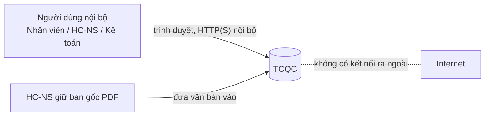
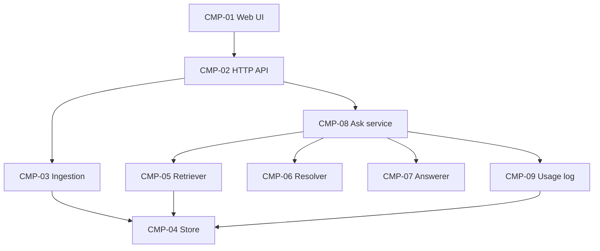
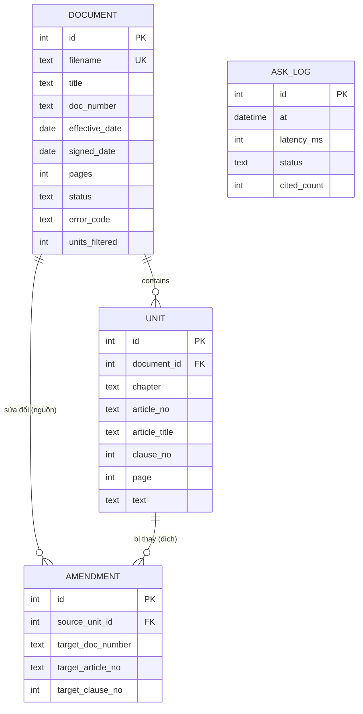

# SAD — Tra cứu quy chế (TCQC)

| Mục | Giá trị |
|---|---|
| Document ID | TCQC-SAD |
| Version | 0.1 |
| Status | In review |
| Owner / Approver | Phùng Duy Hùng (PO, kiêm Tech Lead) |
| Author | AI agent (Claude Code) |
| Date | 2026-11-02 |
| Prompt | `sdlc-kit/design/SAD_Prompt_IEEE_standard.md` v2.0; tham số `prompts/04-design.md` |
| Đầu vào | PRD/US/traceability v1.0 (`analysis-v1`), BRD v1.0 (`requirements-v1`), SRC-006 |
| Liên quan | [blueprint.md](blueprint.md) (thiết kế chi tiết), [adr/](adr), [diagrams/](diagrams) |

## 1. Architectural Goals & Design Principles

### 1.1 Drivers (nêu trước khi thiết kế)

| Driver | Nguồn | Hệ quả kiến trúc |
|---|---|---|
| Căn cứ đúng Điều/Khoản, đúng văn bản đang hiệu lực | FR-007..FR-010, FR-019, FR-020; MET-002/003 | Đơn vị lưu trữ và truy xuất là **Khoản trong một Điều**, có thông tin văn bản; luật hiệu lực là một thành phần riêng, kiểm thử được |
| Không có nội dung rời khỏi công ty; không dịch vụ AI ngoài | SRC-006 D4, D5; BR-011 | Thành phần tạo câu trả lời chạy trong tiến trình, theo quy tắc, nằm sau một port để thay được về sau (ADR-001) |
| p90 ≤ 30 giây; 10 câu đồng thời; văn bản 20 trang ≤ 60 giây | NFR-001, NFR-006, NFR-002 | Tìm kiếm từ khóa trong bộ nhớ trên ≤ 50 văn bản là đủ (ADR-003); xử lý văn bản đồng bộ trong yêu cầu tải lên (ADR-004) |
| Hoàn thành trong ngày, một người | CON-01 | Modular monolith, một tiến trình, CSDL nhúng (ADR-002), giao diện tĩnh không cần build |
| Không lưu nội dung vào log/số liệu | BR-011, NFR-003 | Bảng số liệu chỉ có cột số; log có cấu trúc, không có trường văn bản (§4.2) |
| Văn bản có thể chứa chỉ dẫn xấu | BR-012, RSK-003 | Bộ lọc chỉ dẫn lúc xử lý văn bản; thành phần trả lời không thực thi văn bản (§4.1) |

### 1.2 Constraints

CON-01..07 (BRD §4.9). Ràng buộc công nghệ: chạy được trên máy Windows của PO với Python 3.12+ đã có sẵn, không cần Docker (DEP-004). Không có ràng buộc pháp lý (CON-02).

### 1.3 Principles

1. **Ports & adapters:** nghiệp vụ (`app/domain`, `app/services`) không import framework web, thư viện PDF hay SQL.
2. **Căn cứ là dữ liệu, không phải văn bản tự do:** mọi câu trả lời được dựng từ danh sách đơn vị (Khoản) có ID; [n] ánh xạ 1-1 tới căn cứ.
3. **Thời gian là tham số:** luật hiệu lực nhận `today` từ một clock được tiêm vào, nên kiểm thử được văn bản tương lai.
4. **Fail closed:** không đủ bằng chứng thì trả câu "không tìm thấy", không đoán.

## 2. System Component Decomposition

### 2.1 Context (C4 L1)

Hệ thống cung cấp ba dịch vụ: đưa văn bản vào (IF-01), xem danh sách (IF-02), tra cứu (IF-03). Hệ thống không phụ thuộc dịch vụ bên ngoài nào khi chạy.

### 2.2 Components (C4 L2/L3)

Sơ đồ có thể chỉnh sửa: [diagrams/component.drawio](diagrams/component.drawio).

| ID | Component | Trách nhiệm | Interface | FR / NFR |
|---|---|---|---|---|
| CMP-01 | Web UI | Hai màn hình Tra cứu, Văn bản; kiểm tra số tệp và độ dài câu hỏi phía trình duyệt | Gọi CMP-02 qua JSON | FR-001, FR-004, FR-006, FR-008, FR-013, FR-015, FR-018, NFR-007 |
| CMP-02 | HTTP API | Định tuyến, kiểm tra đầu vào, ánh xạ lỗi sang mã lỗi + thông điệp tiếng Việt | `POST /api/documents`, `GET /api/documents`, `POST /api/ask`, `GET /healthz` (blueprint §5) | IF-01..03 |
| CMP-03 | Ingestion | Kiểm tra tệp, trích văn bản theo trang, nhận diện Chương/Điều/Khoản, số hiệu, tên, ngày hiệu lực, liên kết sửa đổi; lọc chỉ dẫn | `ingest(filename, bytes) -> IngestResult` | FR-001..003, FR-012, FR-016, NFR-002, NFR-010 |
| CMP-04 | Store | Lưu văn bản, đơn vị (Khoản), liên kết sửa đổi, số liệu | Port `DocumentStore`; adapter SQLite | FR-004, FR-005, FR-014 |
| CMP-05 | Retriever | Xếp hạng đơn vị theo câu hỏi (BM25) trên các văn bản Sẵn sàng | Port `Retriever.search(question, k) -> list[Hit]` | FR-005, FR-007 |
| CMP-06 | Effective-date resolver | Áp dụng BRU-001/002/003: chọn đơn vị đang áp dụng, đơn vị bị thay, đơn vị sắp có hiệu lực | `resolve(hits, today) -> Resolution` | FR-009, FR-010, FR-020 |
| CMP-07 | Answerer | Dựng câu trả lời có [n] từ Resolution, hoặc câu "không tìm thấy" | Port `Answerer.answer(question, resolution) -> Answer`; adapter `RuleBasedAnswerer` (ADR-001) | FR-007, FR-008, FR-011, FR-019 |
| CMP-08 | Ask service | Điều phối CMP-05 → 06 → 07, đo thời gian, timeout 30 giây, ghi số liệu | `ask(question) -> AskResult` | FR-014, FR-015, FR-017, NFR-001, NFR-006 |
| CMP-09 | Usage log | Ghi một bản ghi số liệu mỗi câu hỏi, không có nội dung | Port `UsageLog.record(UsageRecord)` | FR-014, FR-017, NFR-003 |

### 2.3 Dependency view

Quy tắc phụ thuộc: `api → services → domain/ports ← adapters`. Chỉ `app/wiring.py` khởi tạo adapter. Một test import-rule kiểm tra quy tắc này. Thư viện ngoài: FastAPI/uvicorn (CMP-02), PyMuPDF (CMP-03), sqlite3 thư viện chuẩn (CMP-04).

## 3. Data Architecture & Integration Flows

### 3.1 Information view

Chi tiết cột và ràng buộc ở [blueprint.md](blueprint.md) §4. ASK_LOG không có cột văn bản (NFR-003).

### 3.2 Flow F1 — Đưa văn bản vào (US-001, US-002)

Sơ đồ: [diagrams/sequence-ingest.drawio](diagrams/sequence-ingest.drawio).

1. UI kiểm tra ≤ 10 tệp; nếu quá thì chặn ngay, không gửi (FR-001).
2. API nhận multipart. Nếu kho + số tệp > 50, các tệp vượt bị từ chối với `collection_full` (FR-016).
3. Với từng tệp, độc lập với các tệp khác:
   - kiểm tra magic `%PDF-` → `not_pdf`;
   - ≤ 20 MB → `file_too_large`;
   - trùng tên → `duplicate_name`.
4. Mở bằng PyMuPDF:
   - lỗi khi mở → `corrupted`;
   - có mật khẩu → `encrypted_pdf`;
   - > 300 trang → `too_many_pages`;
   - trung bình < 30 ký tự/trang → `no_text_layer`.
5. Nhận diện cấu trúc, metadata và liên kết sửa đổi (blueprint §6.1–6.3); lọc đơn vị chứa chỉ dẫn (§6.6).
6. Ghi văn bản, các đơn vị và liên kết trong một transaction; trạng thái `ready`. Lỗi ở bước 4–6 → `failed` + mã lỗi. Transaction rollback nên không để lại đơn vị dở dang.
7. Trả về kết quả từng tệp. UI làm mới danh sách (FR-018).

**Lỗi:** một tệp lỗi không ảnh hưởng tệp khác (FR-002). Lỗi CSDL → `storage_error` cho tệp đó. Không có retry tự động vì xử lý đồng bộ: người dùng đưa lại tệp.

### 3.3 Flow F2 — Tra cứu (US-003..006, US-008, US-010)

Sơ đồ: [diagrams/sequence-ask.drawio](diagrams/sequence-ask.drawio).

1. API kiểm tra 1–2000 ký tự (`question_invalid`) và phải có ≥ 1 văn bản Sẵn sàng (`no_documents`, FR-013).
2. Ask service bắt đầu đo thời gian, timeout 30 giây (FR-015).
3. Retriever trả top-k đơn vị theo BM25 (blueprint §6.4).
4. Resolver áp dụng luật hiệu lực với `today` (blueprint §6.5):
   - đơn vị bị sửa đổi bởi văn bản đã hiệu lực → dùng đơn vị sửa đổi, ghi đơn vị bị thay;
   - văn bản sửa đổi chưa hiệu lực → giữ đơn vị cũ, ghi "sắp có hiệu lực".
5. Answerer:
   - điểm < ngưỡng hoặc không đủ từ trùng → câu FR-011, không có căn cứ;
   - ngược lại → câu trả lời là nội dung Khoản, kèm [1] và các chú thích thay thế / sắp hiệu lực [2]…
6. Ghi ASK_LOG (latency, status, cited_count). Nếu ghi lỗi thì chỉ log mã lỗi và vẫn trả lời (FR-017).
7. Trả `{answer, latency_ms, sources[]}`.

**Lỗi:** exception hoặc timeout trong bước 3–5 → ghi ASK_LOG status = error → HTTP 503 `ai_unavailable`. UI giữ câu hỏi và hiện "Hỏi lại" (FR-015).

### 3.4 State dynamics

Văn bản: `(upload) → processing → ready | failed`. Không có chuyển trạng thái nào khác trong phạm vi này; gỡ văn bản là Deferred. Trạng thái `processing` chỉ tồn tại trong thời gian của một yêu cầu tải lên (ADR-004).

### 3.5 Interface view

Hợp đồng API và mã lỗi: [blueprint.md](blueprint.md) §5. Không có giao diện với hệ thống bên ngoài (SRC-006 D4).

## 4. Cross-Cutting Concerns & Infrastructure

### 4.1 Security

| Mối đe dọa | Biện pháp | Yêu cầu |
|---|---|---|
| Truy cập từ ngoài | Mặc định chỉ lắng nghe `127.0.0.1`. Khi triển khai: sau reverse proxy HTTPS, giới hạn dải IP nội bộ | NFR-004, BR-014 |
| Văn bản chứa chỉ dẫn xấu | Không thực thi hay diễn giải văn bản như lệnh (không có LLM); bộ lọc §6.6 loại câu chỉ dẫn khỏi đơn vị được trả lời | BR-012, FR-012 |
| Tệp độc | Chỉ nhận `%PDF-`; giới hạn kích thước trước khi đọc toàn bộ; PyMuPDF mở trong try/except | FR-002 |
| XSS từ nội dung văn bản | UI chèn câu trả lời bằng `textContent`, không dùng `innerHTML` | — |
| Lộ nội dung | §4.2 | BR-011 |

Không có xác thực hay phân quyền (OQ-002, NFR-008). Không có bí mật nào trong cấu hình.

### 4.2 Observability & data protection

- Log JSON một dòng mỗi sự kiện, gồm `event`, `document_id`, `pages`, `units`, `filtered`, `error_code`, `latency_ms`. **Không có trường chứa câu hỏi, câu trả lời hay văn bản.**
- ASK_LOG chỉ có cột số và trạng thái.
- Kiểm thử NFR-003: tìm chuỗi câu hỏi mẫu trong log và tệp CSDL sau khi chạy golden set.

### 4.3 Reliability

- SQLite chế độ WAL, transaction cho mỗi tệp.
- Phục hồi bằng cách đưa lại bản gốc (NFR-005, RPO theo ASM-005). Diễn tập: xóa tệp CSDL, đưa lại 3 văn bản mẫu.

### 4.4 Performance & resources

| Tài nguyên | Ước tính | Căn cứ |
|---|---|---|
| Kho | ≤ 50 văn bản × ≤ 300 trang; mẫu: < 100 đơn vị | NFR-010 |
| Chỉ mục BM25 | Dựng lại trong bộ nhớ khi kho thay đổi; < 1 MB với kho mẫu | ADR-003 |
| Tra cứu | Dò toàn bộ chỉ mục: mili-giây với ≤ 10⁴ đơn vị, nên NFR-001 dư nhiều | NFR-001 |
| Đồng thời | uvicorn + threadpool; SQLite chỉ đọc khi tra cứu | NFR-006 |
| Máy | 1 CPU, 512 MB RAM là đủ | — |

### 4.5 Deployment (physical view)

| Node | Thành phần | Ghi chú |
|---|---|---|
| Máy chủ nội bộ (capstone: máy Windows của PO) | Tiến trình `uvicorn app.main:app` chứa CMP-01..09; tệp `data/tcqc.db` | Python 3.12+, venv; lệnh chạy trong README |
| Trình duyệt người dùng | CMP-01 (HTML/JS tĩnh do CMP-02 phục vụ) | Chrome/Edge/Firefox |

## 5. Requirement → component map

| FR / NFR | Component |
|---|---|
| FR-001, FR-002, FR-016 | CMP-01, CMP-02, CMP-03 |
| FR-003 | CMP-03 |
| FR-004, FR-018 | CMP-01, CMP-02, CMP-04 |
| FR-005 | CMP-04, CMP-05 |
| FR-006, FR-013 | CMP-01, CMP-02 |
| FR-007, FR-008, FR-011, FR-019 | CMP-05, CMP-07 |
| FR-009, FR-010, FR-020 | CMP-06 |
| FR-012 | CMP-03 (§6.6), CMP-07 |
| FR-014, FR-017 | CMP-08, CMP-09 |
| FR-015 | CMP-01, CMP-08 |
| NFR-001, NFR-006 | CMP-05, CMP-08 (§4.4) |
| NFR-002, NFR-010 | CMP-03 |
| NFR-003 | CMP-09, §4.2 |
| NFR-004, NFR-008, NFR-009 | §4.1, §4.5 |
| NFR-005 | §4.3 |
| NFR-007 | CMP-01, CMP-02 (thông điệp lỗi) |

## 6. ADR index

| ADR | Quyết định | Trạng thái |
|---|---|---|
| [ADR-001](adr/ADR-001-rule-based-answerer.md) | Câu trả lời do `RuleBasedAnswerer` trong tiến trình tạo ra, sau port `Answerer` | Đề xuất |
| [ADR-002](adr/ADR-002-sqlite.md) | Lưu trữ bằng SQLite nhúng | Đề xuất |
| [ADR-003](adr/ADR-003-bm25-clause-units.md) | Truy xuất BM25 trên đơn vị Khoản | Đề xuất |
| [ADR-004](adr/ADR-004-sync-ingestion-static-ui.md) | Xử lý văn bản đồng bộ trong yêu cầu tải lên; giao diện HTML/JS tĩnh | Đề xuất |

## 7. Open questions

| ID | Câu hỏi | Owner | Cần trước |
|---|---|---|---|
| — | Không có câu hỏi mở mới ở chặng Design | — | — |
