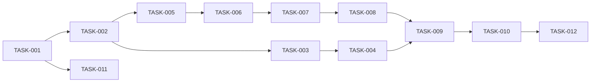

# WBS — Tra cứu quy chế

| Mục | Giá trị |
|---|---|
| Document ID | TCQC-WBS |
| Version | 0.1 |
| Status | In review |
| Owner / Approver | Phùng Duy Hùng (PO) |
| Date | 2026-11-02 |
| Prompt | `sdlc-kit/development/TaskBreakdown_ISO_21511_Prompt.md` v2.0 |
| Đầu vào | SAD v1.0, blueprint v1.0, ADR-001..004 (`design-v1`); PRD/US v1.0 (`analysis-v1`); [Software_Development_Plan.md](Software_Development_Plan.md) |

## 1. Scope baseline

Phạm vi đúng bằng PRD v1.0 (FR-001..020, NFR-001..010). Không có phần tử WBS nào ngoài PRD (ISO 21511 nguyên tắc 100 %).

## 2. Product breakdown và WBS

| Số | ID | Phần tử | Task | Priority | Wave | Giờ | Phụ thuộc | Yêu cầu |
|---|---|---|---|---|---|---|---|---|
| 1.1 | WBS-11 | Khung mã nguồn | TASK-001 | P0 | W1 | 0.5 | — | NFR-007 |
| 1.2 | WBS-12 | Kiểu miền và lỗi | TASK-002 | P0 | W1 | 0.5 | TASK-001 (FS) | FR-002, FR-006, NFR-007 |
| 2.1 | WBS-21 | Nhận diện văn bản | TASK-003 | P0 | W1 | 1.0 | TASK-002 (FS) | FR-003, FR-009, FR-010, US-002 |
| 2.2 | WBS-22 | Xử lý tệp | TASK-004 | P0 | W1 | 1.0 | TASK-003 (FS), TASK-005 (SS) | FR-001, FR-002, FR-012, FR-016, NFR-002, NFR-010, US-001, US-008 |
| 2.3 | WBS-23 | Lưu trữ | TASK-005 | P0 | W1 | 0.5 | TASK-002 (FS) | FR-004, FR-005, FR-014, FR-017, NFR-003, US-007 |
| 3.1 | WBS-31 | Truy xuất | TASK-006 | P0 | W2 | 0.5 | TASK-005 (FS) | FR-005, FR-007, NFR-001 |
| 3.2 | WBS-32 | Luật hiệu lực | TASK-007 | P0 | W2 | 1.0 | TASK-006 (FS) | FR-009, FR-010, FR-020, US-004, US-006 |
| 3.3 | WBS-33 | Dựng câu trả lời | TASK-008 | P0 | W2 | 0.75 | TASK-007 (FS) | FR-007, FR-008, FR-011, FR-019, US-003, US-005 |
| 3.4 | WBS-34 | API và dịch vụ hỏi | TASK-009 | P0 | W2 | 0.75 | TASK-004 (FS), TASK-008 (FS) | FR-001, FR-006, FR-013, FR-014, FR-015, FR-017, NFR-001, NFR-006, US-001, US-003, US-007, US-009, US-010 |
| 4.1 | WBS-41 | Giao diện | TASK-010 | P0 | W2 | 1.0 | TASK-009 (FS) | FR-001, FR-004, FR-006, FR-008, FR-013, FR-015, FR-018, NFR-007, US-001, US-002, US-003, US-009, US-010 |
| 5.1 | WBS-51 | Dữ liệu mẫu và golden set | TASK-011 | P0 | W1 | 0.75 | TASK-001 (FS) | DEP-002, DEP-003, MET-002, MET-003, MET-004, MET-007 |
| 6.1 | WBS-61 | Review code | TASK-012 | P0 | W3 | 0.5 | TASK-010 (FS) | RC-5 |

Tổng ước lượng: 8.75 giờ (ước lượng theo kinh nghiệm, độ tin cậy Medium).

| Deliverable | Phần tử |
|---|---|
| DEL-1 Khung và miền | 1.x |
| DEL-2 Kho văn bản | 2.x |
| DEL-3 Tra cứu | 3.x |
| DEL-4 Giao diện | 4.x |
| DEL-5 Dữ liệu kiểm thử | 5.x |
| DEL-6 Review | 6.x |

## 3. Sequencing (đường găng)

Đường găng: TASK-001 → 002 → 005 → 006 → 007 → 008 → 009 → 010 → 012.

## 4. RACI

| Hoạt động | PO | AI agent |
|---|---|---|
| Viết code và test (TASK-001..011) | A | R |
| Review code (TASK-012) | A/R (duyệt) | R (soạn biên bản) |
| Duyệt cổng Build | A/R | I |

## 5. Traceability

Mọi task trỏ về FR/NFR/US (cột Yêu cầu). Mọi FR-001..020 có ít nhất một task: FR-001 (004, 009, 010), FR-002 (002, 004), FR-003 (003), FR-004 (005, 010), FR-005 (005, 006), FR-006 (002, 009, 010), FR-007 (006, 008), FR-008 (008, 010), FR-009/010/020 (003, 007), FR-011 (008), FR-012 (004), FR-013 (009, 010), FR-014 (005, 009), FR-015 (009, 010), FR-016 (004), FR-017 (005, 009), FR-018 (010), FR-019 (008). NFR-001 (006, 009), NFR-002 (004), NFR-003 (005), NFR-006 (009), NFR-007 (001, 002, 010), NFR-010 (004). NFR-004/005/008/009 được kiểm bằng Inspection ở chặng Test (không cần code).
